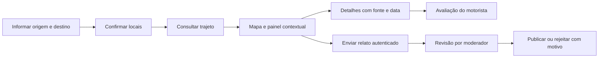

# Produto e funcionamento

## Problema e público

Motoristas podem conhecer o valor oferecido por uma corrida e ainda ter informações incompletas sobre a região e o caminho. O SafeRide pretende apoiar a consulta desse contexto antes da decisão, com o veículo parado.

As perguntas centrais são: como é a região de embarque e destino, quais condições do percurso foram registradas e o que outros motoristas relataram?

## Evidência inicial

Fonte: roteiro dos slides 3 a 8 fornecido pelo grupo. Pesquisa exploratória com 14 respostas; os dados brutos e o questionário ainda precisam ser anexados em versão anonimizada.

| Resultado informado | Pessoas | Percentual |
| --- | ---: | ---: |
| Insegurança frequente em regiões desconhecidas | 7/14 | 50% |
| Informações atuais não atendem ou atendem pouco | 8/14 | 57,1% |
| Utilizariam com certeza ou provavelmente | 14/14 | 100% |
| Prioridade para condições do pavimento | 10/14 | 71,4% |
| Prioridade para dados atualizados | 10/14 | 71,4% |

Os resultados indicam necessidades e interesse declarado entre os participantes. Não demonstram adoção real, representatividade dos motoristas ou redução de riscos. As duas prioridades não devem ser somadas como se fossem grupos exclusivos.

## Proposta para a primeira versão

A entrega atual é um protótipo local para apresentação. Além das quatro funções abaixo, a primeira versão inclui busca automática de notícias regionais e fallback para fontes alternativas, dados salvos e demonstração identificada. A lista regional não exige cadastro manual; ocorrências no mapa exigem localização suficiente e revisão. O [plano de notícias](05-integracao-noticias.md) detalha esse fluxo. Um piloto público fica para uma etapa posterior.

Aplicação web responsiva com React no frontend e Java com Spring Boot no backend, conforme requisito confirmado pelo proprietário. Um município ou área piloto limita o esforço de levantamento e revisão de dados. A cidade ainda será escolhida.

| Função | Comportamento esperado |
| --- | --- |
| Mapa | Mostrar origem, destino e registros disponíveis na área consultada, com alternativa em lista |
| Relatos | Consultar registros publicados e enviar observações sobre vias e locais para moderação |
| Trajetos | Informar origem e destino manualmente e visualizar um percurso calculado por um provedor |
| Painel contextual | Resumir registros do embarque, destino e percurso, indicando fonte, data e lacunas |

Cadastro e moderação são funções de suporte necessárias aos relatos. A consulta pode ser pública; publicar exige autenticação. Isso é uma proposta de acesso a validar pelo grupo.

## Jornada do motorista

1. Abre o SafeRide e informa origem e destino. A localização atual é opcional, solicitada somente após uma ação explícita.
2. Confirma os endereços encontrados para evitar consultar outro lugar com nome semelhante.
3. Solicita o trajeto e visualiza o percurso no mapa.
4. Abre o painel com registros próximos ao embarque, destino e caminho. Pode filtrar por categoria e recência.
5. Consulta um registro para entender a observação, a origem da informação, quando ocorreu e quando foi atualizada.
6. Faz sua própria avaliação fora do aplicativo. Não há botão automático para aceitar uma corrida em outra plataforma.
7. Opcionalmente, entra na conta e registra uma observação para revisão.

## Telas propostas

| Tela | Conteúdo principal |
| --- | --- |
| Consulta | Campos de origem e destino, confirmação de endereços e ação de consultar |
| Resultado | Mapa, percurso e painel que também funciona como lista acessível |
| Detalhe do registro | Categoria, descrição, localização, fonte, datas e opção de denunciar |
| Envio de relato | Local ou trecho, categoria, data da observação e descrição curta |
| Minha conta | Autenticação, edição do perfil com plataformas de trabalho, atividade e veículo, meus relatos, status e exclusão dos meus relatos |
| Moderação | Fila de relatos e denúncias, publicação, rejeição e retirada com motivo |

## Regras de conteúdo

O perfil permite múltiplas plataformas de trabalho, incluindo opções de outra plataforma e trabalho independente. As informações são autodeclaradas, editáveis e públicas na comunidade, conforme o [plano de perfis](06-comunidade-perfis.md). Não representam vínculo verificado nem alteram as regras de moderação dos relatos.

Categorias iniciais propostas: pavimento, obra/interdição e condição de acesso. A prioridade é informação observável sobre o território. Fotos, comentários, avaliações de passageiros e acusações contra pessoas ficam fora do MVP.

Cada registro exibe a data da observação e sua fonte. Relato comunitário é apresentado como relato, mesmo depois da revisão; moderação não equivale a comprovação factual. Registros contraditórios podem coexistir com datas e autoria pública pseudonimizada.

Ausência de registros aparece como “Sem informações disponíveis para esta área”. Dados antigos e fonte indisponível têm estados próprios. Nenhum desses estados significa que o local é seguro.

## Fora da primeira versão

Integração com plataformas de corrida, precificação, navegação curva a curva, acompanhamento contínuo da localização, rastreamento de passageiros, previsão de crimes, pontuação de segurança, inteligência artificial, chat e gamificação.

## Validação da proposta

Realizar uma rodada proposta com cinco motoristas, sem condução durante o teste. Observar se conseguem consultar um percurso, localizar fonte e data, perceber falta de informação e distinguir relato de dado público. Registrar tempo, erros e comentários sem coletar trajetos pessoais reais.

Meta inicial de usabilidade: pelo menos quatro dos cinco completarem a consulta sem ajuda. É um critério de iteração do protótipo, não uma estimativa de aceitação do mercado. Se falhar, revisar a experiência antes de ampliar o escopo.
