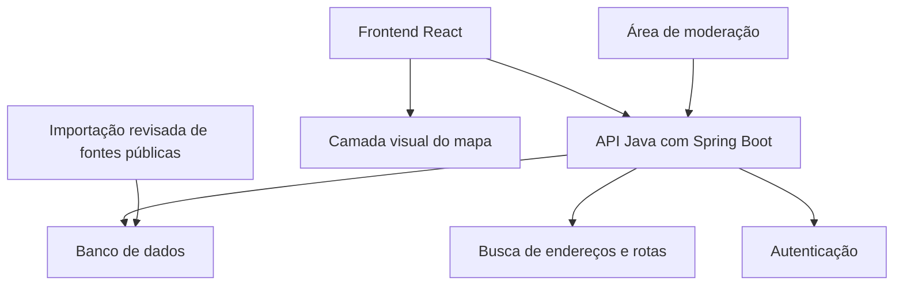

# Arquitetura e dados

## Organização proposta

Uma aplicação responsiva acessa uma API com regras de negócio e um banco com suporte a consultas espaciais. Adaptadores isolam os serviços de mapa, busca de endereços e cálculo de rotas. O provedor do mapa não necessariamente oferece os outros dois serviços.

React no frontend e Java com Spring Boot no backend são requisitos confirmados. Banco, hospedagem, fornecedores, versões e ferramentas de build ainda serão definidos. Essas escolhas devem considerar familiaridade do grupo, exigências da disciplina, cobertura da cidade piloto, limites, custo e direitos de uso. Não criar dependência de contas da Advanced.

## Responsabilidades de cada aplicação

O frontend React, em `apps/web/`, reúne as telas de consulta, mapa, painel contextual, envio de relatos e moderação. Ele apresenta os estados de carregamento e erro e consome a API por HTTP com JSON.

O backend Java com Spring Boot, em `services/api/`, concentra validação, autorização, regras dos relatos, moderação, consultas de contexto e acesso ao banco. As integrações que exigem credenciais privadas ficam no backend. A interface nunca é a única responsável por verificar permissões.

Manter os dois componentes no mesmo repositório, com configuração e instruções de execução próprias. Separar no backend a entrada HTTP, os serviços de negócio, a persistência e os adaptadores externos. Definir os contratos da API antes de dividir a implementação entre integrantes.

A primeira entrega técnica deve demonstrar uma chamada do React a um endpoint do Spring Boot. Versões, ferramenta de build do frontend, gerenciador de dependências Java, banco e mecanismo de autenticação permanecem pendentes; não são necessários para fechar o planejamento funcional.

## Como formar o painel

1. Validar e resolver origem e destino em coordenadas.
2. Solicitar a geometria do trajeto ao provedor de rotas.
3. Buscar registros publicados próximos dos pontos e da linha do trajeto.
4. Aplicar filtros de categoria e período; excluir registros retirados ou expirados.
5. Separar contexto de embarque, destino e caminho, sem contar o mesmo registro duas vezes no total.
6. Retornar fonte, data da observação, atualização e estado de disponibilidade junto aos registros.

Parâmetro inicial de desenvolvimento: raio de 300 m nos pontos e corredor de 100 m ao redor do percurso, medidos em metros por operação espacial adequada. São hipóteses configuráveis; testar em vias paralelas e áreas densas antes do piloto. Proximidade geométrica não prova que o registro pertence à mesma via, então a interface deve usar “próximo ao percurso” quando não houver associação confirmada.

Se a rota falhar, manter consulta por região e explicar a falha. Se uma fonte externa estiver fora do ar, marcar a indisponibilidade e a data do último dado armazenado, quando houver. Não substituir falha por contagem zero.

## Modelo inicial de dados

| Entidade | Campos essenciais |
| --- | --- |
| Perfil | ID, identificador de autenticação, nome público, papel, criação |
| Relato | ID, autor, categoria, descrição, ponto ou trecho, data da observação, criação, atualização, validade, status |
| Fonte pública | ID, nome, endereço de origem, condições de uso, cobertura, frequência esperada, última importação bem-sucedida |
| Registro público | ID, fonte, identificador externo, categoria, geometria, observação, atualização, validade, conteúdo normalizado |
| Denúncia | ID, relato, solicitante, motivo, criação, status |
| Ação de moderação | ID, moderador, relato ou denúncia, ação, motivo, data |

Consultas de trajetos não precisam ser persistidas no MVP. Credenciais de autenticação ficam a cargo do mecanismo escolhido; não armazenar senhas em campos do perfil.

## Ciclo de vida do relato

`pendente → publicado ou rejeitado`; `publicado → retirado ou expirado`. Editar conteúdo publicado retorna o relato à revisão e retira a versão da consulta pública até nova decisão. O autor pode excluir seu próprio relato. O registro público não expõe email ou identificador de autenticação.

Proposta de validade: relatos expiram após 30 dias da observação, com o prazo configurável por categoria. Uma nova observação exige nova data, sem renovar automaticamente um relato antigo. Obras e interdições podem ter prazo próprio. Esses prazos são regras de produto a validar, não indicadores de precisão.

## Contratos funcionais propostos

| Operação | Entrada | Saída e regra principal |
| --- | --- | --- |
| Buscar endereços | Texto e área piloto | Candidatos com nome e coordenadas |
| Consultar trajeto | Origem e destino confirmados | Geometria e estimativas identificadas como estimativas |
| Consultar contexto | Área ou geometria, categoria e período | Registros paginados, fontes, datas e disponibilidade |
| Enviar relato | Local, categoria, observação e descrição | ID e status pendente; exige usuário autenticado |
| Consultar meus relatos | Sessão | Apenas registros do próprio autor |
| Denunciar relato | ID e motivo | Protocolo para revisão; exige autenticação no MVP |
| Moderar | ID, ação e motivo | Transição auditada; exige papel de moderador |

Validar tamanho do texto, coordenadas, área suportada e datas; bloquear observação no futuro. Aplicar limitação de frequência no servidor e retornar erros compreensíveis. Verificar permissões no servidor em todas as operações, não apenas ocultar botões.

## Fontes e demonstração

O [módulo de notícias](05-integracao-noticias.md) acrescenta fontes editoriais, publicações, ocorrências, evidências e execuções de coleta. A primeira entrega local inclui coleta automática RSS/API em segundo plano e fallback: fontes alternativas, notícias persistidas e modo demo explicitamente identificado. Notícias elegíveis aparecem na lista regional; ocorrências revisadas entram no mapa e contexto com precisão espacial e atualidade explícitas. O documento do módulo define estados de falha, contratos, limites e responsabilidades de React e Spring Boot.

A primeira demonstração utiliza uma base fictícia pequena, marcada visualmente. Para o piloto real, escolher uma fonte pública concreta com cobertura útil e registrar origem, atribuição, permissão de reutilização e atualização. A existência e a adequação dessa fonte ainda não foram comprovadas.

Um arquivo revisado pode apoiar outras bases públicas, mas não substitui a coleta automática de notícias exigida no MVP. Não presumir API aberta, cobertura nacional ou atualização em tempo real. A importação deve evitar duplicação por fonte e identificador externo e preservar a data original.

## Proteção dos dados e operação

Coletar apenas o necessário ao fluxo. Não publicar nomes de passageiros, placas, telefones, endereços residenciais identificados como pertencentes a pessoas ou acusações pessoais. Textos passam por revisão antes da publicação. Logs não devem conter senhas, tokens ou coordenadas precisas de consultas.

Guardar segredos fora do Git. Separar dados fictícios e piloto real. Preparar exclusão de conta e relatos, procedimento de restauração do banco e limites de consumo dos provedores antes do piloto. Definir responsável por moderação e incidentes; se não houver responsável, manter apenas a demonstração fechada.

## Verificações necessárias na implementação

- Um usuário não altera relato de outro nem acessa ações de moderador.
- Relatos pendentes, retirados e expirados não aparecem na consulta pública.
- Uma falha externa não vira “sem registros”.
- Consulta espacial funciona nas bordas do corredor e não duplica registros.
- Datas, fonte e identificação de dados fictícios aparecem em mapa e lista.
- O fluxo principal funciona em tela de celular, com teclado e sem depender apenas de cores.
