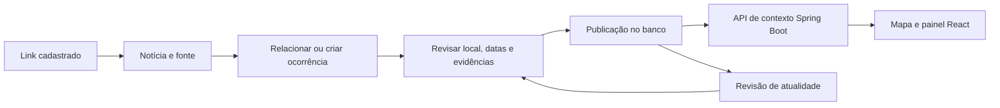

# Integração de notícias e ocorrências locais

## Objetivo e escopo

Integrar notícias e comunicados sobre obras, interdições e alagamentos ao mapa e ao painel contextual do SafeRide, apoiando motoristas e entregadores. Este documento define o funcionamento planejado; o módulo ainda não foi implementado.

A primeira entrega usa cadastro manual de links e revisão por moderador na cidade piloto. Coleta por RSS ou API, extração assistida por IA e sugestões de links pelos membros ficam como evoluções. Os fornecedores e suas condições de uso ainda precisam ser verificados. Notícias não alteram automaticamente o trajeto nem geram uma classificação de segurança de bairros.

## Fluxo completo

1. Moderador cadastra a publicação e identifica sua fonte original.
2. Registra resumo, categoria, local, data do acontecimento e data da publicação separadamente.
3. Procura ocorrência existente antes de criar outra; novas matérias podem complementar o mesmo acontecimento.
4. Confirma a localização no mapa, a precisão disponível e as evidências que sustentam a informação.
5. Publica a ocorrência com prazo para nova revisão. Revisão editorial não equivale a confirmação oficial.
6. O backend inclui ocorrências pertinentes na consulta de contexto; o frontend apresenta fonte, datas e situação.
7. Moderador registra atualizações, correções, retirada ou encerramento com justificativa e evidência.

## Notícias e ocorrências são registros diferentes

Uma notícia é uma publicação de um veículo ou órgão. Uma ocorrência é o acontecimento territorial descrito por uma ou mais publicações. Duas reportagens sobre a mesma interdição geram duas referências e apenas uma ocorrência no mapa.

| Entidade | Campos propostos |
| --- | --- |
| Fonte editorial | ID, nome, domínio, tipo (órgão oficial ou veículo jornalístico), cobertura, atribuição e uso permitido, status de habilitação |
| Notícia | ID, fonte, URL original e normalizada, título, autoria quando disponível, data de publicação, data de cadastro/coleta, resumo próprio e referência à origem da apuração |
| Ocorrência | ID, categoria, resumo, geometria, precisão espacial, início do acontecimento, fim previsto quando informado, situação, última verificação, próxima revisão e versão |
| Evidência da ocorrência | IDs de ocorrência e notícia, informação sustentada, vínculo com fonte primária e data da revisão |
| Histórico de revisão | ID, ocorrência, moderador, ação, motivo, evidência, data e versão anterior |

A relação entre notícias e ocorrências pode ser muitos para muitos: uma matéria pode tratar de mais de um trecho ou acontecimento. Não armazenar o texto integral ou imagens de terceiros por padrão; guardar referência e resumo próprio. Datas desconhecidas permanecem desconhecidas, sem preencher com a data da coleta. Horários devem preservar o fuso da origem quando conhecido.

As entidades deste módulo complementam o modelo de [arquitetura](02-arquitetura.md). Uma notícia não vira automaticamente um relato comunitário nem um registro oficial. Reutilizar o cadastro de fontes existente quando compatível, preservando o tipo e a procedência.

## Critérios para publicação

- Identificar autoria ou organização responsável, link original e evidência para cada afirmação publicada.
- Separar fonte oficial, apuração jornalística e contribuição comunitária na apresentação.
- Verificar a data do acontecimento, mesmo quando a notícia acabou de ser publicada.
- Confirmar a localização e a área efetivamente afetada; citações de locais no texto não bastam.
- Registrar se há comunicado oficial, apuração independente ou somente uma publicação disponível. Não inventar percentuais de confiabilidade.
- Tratar republicações da mesma origem como uma evidência, não como confirmações independentes.
- Em contradições materiais não resolvidas, manter a ocorrência pendente ou retirar sua publicação até revisão.

Uma fonte cadastrada não torna toda matéria automaticamente correta. Conferência humana continua necessária no MVP. O grupo definirá a lista inicial de fontes por cidade; não há fornecedor contratado ou integração ativa.

## Localização e consulta por trajeto

O moderador marca ponto, trecho de via ou área e escolhe a precisão: exata, aproximada ou apenas região. Se o texto só identificar um bairro, usar a área do bairro e informar essa limitação. Sem localização suficiente, manter pendente.

A API consulta interseção ou proximidade entre ocorrências publicadas e os pontos ou a geometria do trajeto. Aplicam-se os parâmetros configuráveis da arquitetura, com verificação de vias paralelas. Uma ocorrência regional aparece como contexto da região, sem afirmar que a via específica está bloqueada.

Deduplicar o resultado por ID da ocorrência, inclusive quando ela alcança embarque, retirada, destino e percurso ao mesmo tempo. Exibir “próximo ao percurso” quando só houver proximidade geométrica. Não recalcular rotas automaticamente nesta entrega.

## Atualidade e estados

| Estado | Visibilidade e regra |
| --- | --- |
| Pendente de revisão | Somente moderação; conteúdo ainda não publicado |
| Publicado | Disponível na consulta com fonte, datas e situação atribuída à evidência |
| Precisa de atualização | Exibido separadamente como informação anterior com situação atual desconhecida; não contar como bloqueio atual confirmado |
| Encerrado | Disponível no histórico, fora da consulta padrão de ocorrências atuais; exige evidência de encerramento |
| Rejeitado | Não publicado, com motivo interno |
| Retirado | Removido da consulta pública após correção necessária ou inadequação; manter histórico de revisão |

Transições: pendente → publicado ou rejeitado; publicado → precisa de atualização, encerrado ou retirado; precisa de atualização → publicado após nova verificação, encerrado com evidência ou retirado. Reabertura de encerrado e revisão de rejeitado/retirado retornam a pendente.

Cada publicação exige uma próxima revisão definida pelo moderador conforme a duração e a categoria. Quando esse prazo passar, o backend deve tratar o registro como desatualizado mesmo se a tarefa periódica atrasar. O prazo de 30 dias proposto para relatos comunitários não se aplica automaticamente às notícias. Vencer um prazo nunca comprova que uma via foi liberada.

Edições materiais de localização, descrição ou evidência retornam a ocorrência à revisão. Registrar correções e evidências no histórico. Uma consulta sem cobertura deve mostrar “Sem informações disponíveis”; falha na consulta deve mostrar indisponibilidade, nunca lista vazia como se não houvesse registros.

## Responsabilidades técnicas

**Spring Boot:** endpoints, validação, autorização por papel, persistência, consulta espacial, deduplicação, histórico de alterações e tratamento de prazos. Organizar controllers, serviços de negócio, repositórios e adaptadores de coleta separados. Verificar versão nas alterações para não sobrescrever a revisão de outro moderador.

**React:** formulário administrativo, fila de revisão, seleção da localização, mapa e lista acessível, filtros por categoria e origem, detalhe com fontes, datas e situação. Diferenciar informações por texto e ícones, sem depender só de cores.

No cadastro manual inicial, o servidor não precisa abrir a URL: o moderador consulta a fonte e preenche o formulário. Se houver busca automática futura, limitar origens a fontes aprovadas, bloquear endereços internos/locais e validar redirecionamentos, tamanho e tempo de resposta. Não renderizar HTML recebido de fontes externas. Segredos de provedores ficam no backend.

## Contratos de API propostos

As rotas abaixo são propostas de implementação, não endpoints existentes. Todas as operações administrativas exigem autenticação e papel de moderador verificados no servidor.

| Método e rota | Finalidade |
| --- | --- |
| POST /api/v1/admin/noticias | Cadastrar URL, fonte, título, datas e resumo; devolver registro existente ou conflito se a URL já estiver cadastrada |
| POST /api/v1/admin/ocorrencias | Criar ocorrência pendente com evidências vinculadas |
| GET /api/v1/admin/ocorrencias | Listar fila paginada por estado e prazo de revisão |
| PATCH /api/v1/admin/ocorrencias/{id} | Editar campos com controle de versão e retorno à revisão quando necessário |
| POST /api/v1/admin/ocorrencias/{id}/revisoes | Publicar, atualizar, encerrar, rejeitar ou retirar, validando transição, justificativa e evidência |
| POST /api/v1/contexto/consulta | Consultar pontos e geometria de trajeto com limites de tamanho, filtros e paginação; incluir ocorrências na resposta de contexto existente |
| GET /api/v1/ocorrencias/{id} | Detalhe público com referências e datas; impedir acesso público a pendentes, rejeitados e retirados |

Respostas de contexto devem identificar tipo de registro, ID, categoria, precisão espacial, situação, última verificação, necessidade de atualização e referências. Não expor dados internos de moderadores. Retornar erros de validação, autorização, conflito de versão e indisponibilidade de forma distinta. Não persistir os trajetos consultados por padrão.

## Exemplo de apresentação

Exemplo inteiramente fictício:

> Interdição noticiada na Avenida Exemplo, entre as ruas A e B. Acontecimento em 02/11/2026 às 08h; última verificação às 09h30, horário de Brasília. Fonte: comunicado municipal de demonstração. Situação atual: sem atualização sobre liberação. Abrir publicação original.

O cartão deve indicar quando estiver desatualizado. Nunca apresentar o horário acima como um evento real ou usar links de exemplo como fontes verificadas.

## Etapas de implementação

1. **MVP manual:** entidades, formulário administrativo, revisão, histórico e publicação no mapa e painel. Usar dados fictícios identificados na demonstração.
2. **Piloto real:** selecionar fontes e validar cobertura, uso, atribuição e rotina de atualização; testar com motoristas e entregadores.
3. **Evolução:** importar fontes RSS/API permitidas para a fila, com deduplicação, limites, tentativas controladas e monitoramento de falhas. Importação nunca publica automaticamente.
4. **Evolução opcional:** membros sugerem links para revisão; IA pode auxiliar extração, sem inventar campos ausentes nem aprovar a veracidade.

## Critérios de aceite

- Moderador cadastra, revisa e publica uma ocorrência que aparece no percurso pertinente e no detalhe com fonte e datas.
- Usuário comum não publica nem acessa filas ou conteúdo pendente por chamadas diretas à API.
- Duas notícias do mesmo evento aparecem como referências de uma ocorrência, sem duplicar marcadores.
- Uma republicação antiga mantém a data original do acontecimento e não renova sua atualidade.
- Informação regional não aparece como ponto exato ou bloqueio confirmado de uma via.
- Vencimento da revisão sinaliza situação atual desconhecida, sem encerrar automaticamente.
- Retirada e encerramento deixam de aparecer como ocorrências atuais; correções ficam auditáveis.
- Falha do serviço, ausência de cobertura e ausência de registros são estados distintos.
- Relatos comunitários e notícias permanecem identificados por origem; nenhuma nota automática de segurança é gerada.
- Fluxo verificado no celular e por teclado, com lista alternativa ao mapa e links de origem utilizáveis.

## Decisões pendentes

Escolher cidade e fontes iniciais; definir responsáveis e frequência de revisão por categoria; estabelecer limites de consulta e política de histórico; validar banco e operações espaciais; priorizar a coleta automatizada após a demonstração manual.
