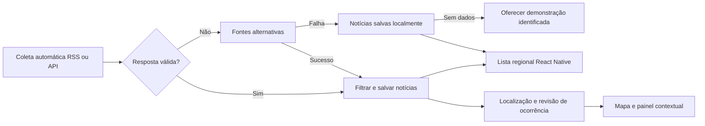

# Integração de notícias e ocorrências locais

## Objetivo e escopo

Integrar notícias e comunicados sobre obras, interdições e alagamentos ao mapa e ao painel contextual do SafeRide, apoiando motoristas e entregadores. Este documento define o funcionamento planejado; o módulo ainda não foi implementado.

A primeira entrega é um protótipo local para apresentação, com busca automática de notícias na internet por RSS ou API e fallback. Não depende de cadastrar links manualmente. A cidade, as fontes e suas condições de uso ainda precisam ser escolhidas e verificadas; nenhum serviço pago está contratado. IA e sugestões de links pelos membros são opcionais para evolução. Notícias não alteram automaticamente o trajeto nem geram uma classificação de segurança de bairros.

## Fluxo completo

1. Spring Boot executa a coleta em fontes previamente configuradas, no início da aplicação e em intervalo configurável. Um botão administrativo também pode solicitar atualização.
2. Filtra por região e assuntos relevantes, valida os campos recebidos e salva título, link, fonte e datas, sem inventar dados ausentes.
3. Evita duplicar publicações por identificador externo e URL normalizada; matérias relacionadas podem ser agrupadas como candidatas à mesma ocorrência.
4. React Native apresenta automaticamente as notícias elegíveis na lista regional, identificadas como publicações da fonte, sem tratá-las como fatos confirmados pelo SafeRide. Região desconhecida fica pendente de classificação.
5. A extração de localização gera candidatos; ocorrência só entra no mapa após localização suficiente e revisão. Uma notícia regional sem endereço preciso continua na lista, sem marcador inventado.
6. Ocorrências aprovadas entram no mapa e painel de trajetos com evidências e prazo de revisão. Revisão editorial não equivale a confirmação oficial.
7. Se a coleta falhar, executar a sequência de fallback abaixo. Moderador pode corrigir ou retirar notícias e revisar ocorrências.

## Fallback e funcionamento local

O aplicativo React Native roda em celular Android ou emulador; Spring Boot e banco rodam no computador da apresentação. Buscar notícias novas exige internet. Consultar dados já persistidos não deve depender de uma nova coleta; a atualização acontece em segundo plano e não bloqueia a interface.

| Situação | Comportamento esperado |
| --- | --- |
| Fonte principal indisponível ou resposta inválida | Tentar fontes alternativas habilitadas para a mesma região e assunto |
| Algumas fontes respondem | Salvar resultados válidos e informar cobertura parcial; preservar dados anteriores das fontes que falharam |
| Todas as fontes falham | Exibir notícias do banco local com data da última coleta bem-sucedida e aviso de atualização indisponível |
| Sem notícias salvas e coleta indisponível | Oferecer ativação explícita do modo de demonstração, com exemplos identificados |
| Resposta válida sem resultados | Mostrar ausência de novos resultados; não tratar como falha nem ativar exemplos automaticamente |
| Localização imprecisa | Manter notícia regional na lista; não criar ponto exato no mapa |
| API local ou banco indisponível | Mostrar erro de serviço local; o cache no banco não resolve essa falha. No perfil demo, oferecer exemplos estáticos empacotados no React Native |

Configuração inicial proposta para teste: atualização a cada 15 minutos, até três fontes por ciclo, timeout de 5 segundos por tentativa, uma repetição para falhas transitórias e orçamento total de 40 segundos por ciclo. Respeitar limites da fonte e Retry-After; não repetir indefinidamente erros de autenticação ou formato. Ajustar os valores após selecionar fornecedores. Não iniciar ciclos sobrepostos; solicitações simultâneas retornam o identificador do ciclo em andamento.

Registrar por fonte a última tentativa, o último sucesso e o motivo da falha. Um ciclo só conta como sucesso após validar e persistir a resposta. Uma resposta válida vazia também é sucesso, mas não muda a data das notícias antigas. Recoletar uma matéria não renova a data do acontecimento nem a verificação de uma ocorrência.

O fallback não apaga registros anteriores, não republica conteúdo retirado e não transforma notícia antiga em informação atual. A interface distingue notícias coletadas, dados locais desatualizados e exemplos. Exemplo de aviso: “Não foi possível atualizar agora. Exibindo informações salvas em 02/11 às 14h.” Exibir fuso e horário real do último sucesso disponível; sem sucesso anterior, informar isso explicitamente.

Dados de demonstração usam armazenamento ou namespace separado, com indicador `demo` no retorno e aviso permanente na tela. Não misturar exemplos nas contagens de dados reais. O botão “Simular falha na coleta” existe somente no perfil local de demonstração, para administradores, e deve poder ser desativado. Ele simula falha dos coletores sem desligar a API ou apagar o banco. Após recuperação, uma coleta bem-sucedida restaura o estado de atualização; sair do modo demo deve ser uma ação explícita.

Para apresentar sem internet, preparar previamente notícias salvas e exemplos estáticos. O fallback de notícias não garante que mapa e cálculo de rota externos funcionem offline: preparar também mapa e percursos demonstrativos locais identificados, sem apresentá-los como navegação atual.

## Notícias e ocorrências são registros diferentes

Uma notícia é uma publicação de um veículo ou órgão. Uma ocorrência é o acontecimento territorial descrito por uma ou mais publicações. Duas reportagens sobre a mesma interdição geram duas referências e apenas uma ocorrência no mapa.

| Entidade | Campos propostos |
| --- | --- |
| Fonte editorial | ID, nome, domínio, tipo (órgão oficial ou veículo jornalístico), cobertura, atribuição e uso permitido, status de habilitação |
| Notícia | ID, fonte, URL original e normalizada, título, autoria quando disponível, data de publicação, data de cadastro/coleta, resumo próprio e referência à origem da apuração |
| Ocorrência | ID, categoria, resumo, geometria, precisão espacial, início do acontecimento, fim previsto quando informado, situação, última verificação, próxima revisão e versão |
| Evidência da ocorrência | IDs de ocorrência e notícia, informação sustentada, vínculo com fonte primária e data da revisão |
| Histórico de revisão | ID, ocorrência, moderador, ação, motivo, evidência, data e versão anterior |
| Execução de coleta | ID, início, fim, fontes tentadas, resultado por fonte, último sucesso, erros, quantidades importadas e identificador de modo demo |

A relação entre notícias e ocorrências pode ser muitos para muitos: uma matéria pode tratar de mais de um trecho ou acontecimento. Não armazenar o texto integral ou imagens de terceiros por padrão; guardar referência e resumo próprio. Datas desconhecidas permanecem desconhecidas, sem preencher com a data da coleta. Horários devem preservar o fuso da origem quando conhecido.

As entidades deste módulo complementam o modelo de [arquitetura](02-arquitetura.md). Uma notícia não vira automaticamente um relato comunitário nem um registro oficial. Reutilizar o cadastro de fontes existente quando compatível, preservando o tipo e a procedência.

## Critérios para publicação

- Identificar autoria ou organização responsável, link original e evidência para cada afirmação publicada.
- Separar fonte oficial, apuração jornalística e contribuição comunitária na apresentação.
- Verificar a data do acontecimento, mesmo quando a notícia acabou de ser publicada.
- Confirmar a localização e a área efetivamente afetada; citações de locais no texto não bastam.
- Registrar se há comunicado oficial, apuração independente ou somente uma publicação disponível. Não inventar percentuais de confiabilidade.
- Tratar republicações da mesma origem como uma evidência, não como confirmações independentes.
- Em contradições materiais não resolvidas, manter a ocorrência pendente ou retirar sua publicação até revisão.

Uma fonte cadastrada não torna toda matéria automaticamente correta. As notícias passam por validação automática de origem, campos e pertinência antes da lista regional; a revisão humana continua necessária para publicar ocorrências no mapa e resolver ambiguidades. O grupo definirá a lista inicial de fontes por cidade; não há fornecedor contratado ou integração ativa. Os estados da seção seguinte se referem às ocorrências; notícias têm estados próprios: elegível para lista, pendente de classificação ou retirada.

## Localização e consulta por trajeto

O moderador marca ponto, trecho de via ou área e escolhe a precisão: exata, aproximada ou apenas região. Se o texto só identificar um bairro, usar a área do bairro e informar essa limitação. Sem localização suficiente, manter pendente.

A API consulta interseção ou proximidade entre ocorrências publicadas e os pontos ou a geometria do trajeto. Aplicam-se os parâmetros configuráveis da arquitetura, com verificação de vias paralelas. Uma ocorrência regional aparece como contexto da região, sem afirmar que a via específica está bloqueada.

Deduplicar o resultado por ID da ocorrência, inclusive quando ela alcança embarque, retirada, destino e percurso ao mesmo tempo. Exibir “próximo ao percurso” quando só houver proximidade geométrica. Não recalcular rotas automaticamente nesta entrega.

## Atualidade e estados

| Estado | Visibilidade e regra |
| --- | --- |
| Pendente de revisão | Somente moderação; conteúdo ainda não publicado |
| Publicado | Disponível na consulta com fonte, datas e situação atribuída à evidência |
| Precisa de atualização | Exibido separadamente como informação anterior com situação atual desconhecida; não contar como bloqueio atual confirmado |
| Encerrado | Disponível no histórico, fora da consulta padrão de ocorrências atuais; exige evidência de encerramento |
| Rejeitado | Não publicado, com motivo interno |
| Retirado | Removido da consulta pública após correção necessária ou inadequação; manter histórico de revisão |

Transições: pendente → publicado ou rejeitado; publicado → precisa de atualização, encerrado ou retirado; precisa de atualização → publicado após nova verificação, encerrado com evidência ou retirado. Reabertura de encerrado e revisão de rejeitado/retirado retornam a pendente.

Cada publicação exige uma próxima revisão definida pelo moderador conforme a duração e a categoria. Quando esse prazo passar, o backend deve tratar o registro como desatualizado mesmo se a tarefa periódica atrasar. O prazo de 30 dias proposto para relatos comunitários não se aplica automaticamente às notícias. Vencer um prazo nunca comprova que uma via foi liberada.

Edições materiais de localização, descrição ou evidência retornam a ocorrência à revisão. Registrar correções e evidências no histórico. Uma consulta sem cobertura deve mostrar “Sem informações disponíveis”; falha na consulta deve mostrar indisponibilidade, nunca lista vazia como se não houvesse registros.

## Responsabilidades técnicas

**Spring Boot:** agendamento e execução da coleta, adaptadores RSS/API, limites de tempo, fallback, persistência local, endpoints, validação, autorização, consulta espacial, deduplicação, histórico e prazos. Organizar controllers, serviços, repositórios e adaptadores separados. Verificar versão nas alterações para não sobrescrever a revisão de outro moderador.

**React Native:** lista automática de notícias, estado da atualização e cobertura, indicadores de dados salvos e modo demo, fila de revisão, seleção da localização, mapa, filtros e detalhe com fontes e datas. Diferenciar informações por texto e ícones, sem depender só de cores. A lista consulta a API local e não acessa fornecedores diretamente.

Os coletores acessam somente fontes aprovadas. Bloquear destinos internos/locais e validar redirecionamentos, tamanho e tempo de resposta. Desabilitar entidades externas no processamento de XML/RSS. Não renderizar HTML recebido de fontes externas. Segredos de provedores ficam no backend. O formulário manual pode existir como ferramenta auxiliar, mas não é requisito para a busca funcionar.

## Contratos de API propostos

As rotas abaixo são propostas de implementação, não endpoints existentes. Todas as operações administrativas exigem autenticação e papel de moderador verificados no servidor.

| Método e rota | Finalidade |
| --- | --- |
| GET /api/v1/noticias | Listar notícias elegíveis por região e categoria, com paginação, origem, datas e identificação de dados reais ou demo |
| POST /api/v1/admin/coletas | Solicitar coleta em segundo plano; retornar ID e estado, sem bloquear a consulta pública |
| GET /api/v1/coletas/status | Informar atualização, cobertura parcial, último sucesso e uso de dados salvos, sem segredos ou erros internos detalhados |
| POST /api/v1/admin/demo/falha-coleta | Ativar ou desativar simulação; indisponível fora do perfil local demo |
| POST /api/v1/admin/noticias | Cadastrar URL, fonte, título, datas e resumo; devolver registro existente ou conflito se a URL já estiver cadastrada |
| POST /api/v1/admin/ocorrencias | Criar ocorrência pendente com evidências vinculadas |
| GET /api/v1/admin/ocorrencias | Listar fila paginada por estado e prazo de revisão |
| PATCH /api/v1/admin/ocorrencias/{id} | Editar campos com controle de versão e retorno à revisão quando necessário |
| POST /api/v1/admin/ocorrencias/{id}/revisoes | Publicar, atualizar, encerrar, rejeitar ou retirar, validando transição, justificativa e evidência |
| POST /api/v1/contexto/consulta | Consultar pontos e geometria de trajeto com limites de tamanho, filtros e paginação; incluir ocorrências na resposta de contexto existente |
| GET /api/v1/ocorrencias/{id} | Detalhe público com referências e datas; impedir acesso público a pendentes, rejeitados e retirados |

Respostas de contexto devem identificar tipo de registro, ID, categoria, precisão espacial, situação, última verificação, necessidade de atualização e referências. Não expor dados internos de moderadores. Retornar erros de validação, autorização, conflito de versão e indisponibilidade de forma distinta. Não persistir os trajetos consultados por padrão.

## Exemplo de apresentação

Exemplo inteiramente fictício:

> Interdição noticiada na Avenida Exemplo, entre as ruas A e B. Acontecimento em 02/11/2026 às 08h; última verificação às 09h30, horário de Brasília. Fonte: comunicado municipal de demonstração. Situação atual: sem atualização sobre liberação. Abrir publicação original.

O cartão deve indicar quando estiver desatualizado. Nunca apresentar o horário acima como um evento real ou usar links de exemplo como fontes verificadas.

## Etapas de implementação

1. **Preparação:** selecionar cidade e fontes principal/alternativas com acesso permitido e testar seu formato. Definir banco e execução local.
2. **Coleta automática no MVP:** implementar adaptadores, filtros, deduplicação, persistência e lista regional no React Native, sem cadastro manual obrigatório.
3. **Fallback no MVP:** fontes alternativas, dados locais, demonstração separada e simulação de falha; preparar roteiro online e offline.
4. **Contexto territorial:** relacionar notícias a ocorrências, revisar localização e publicar no mapa e painel com histórico e datas.
5. **Evolução posterior:** piloto público, sugestões da comunidade e eventual extração assistida por IA. Não fazem parte da infraestrutura necessária à apresentação local.

## Critérios de aceite

- Com banco vazio e fonte acessível, o sistema coleta e mostra notícias sem cadastrar links manualmente.
- Falha da fonte principal aciona alternativa; falha total mantém dados locais e informa o último sucesso.
- Sem internet e sem banco populado, modo demo é oferecido explicitamente e mantém exemplos identificados e separados.
- Resposta vazia, erro de formato, timeout, indisponibilidade da API local e cobertura parcial têm tratamento distinto.
- Retomar a conexão permite nova coleta sem duplicar registros; datas antigas não são renovadas artificialmente.
- Simulação de falha é reversível, não apaga dados e não fica disponível fora do perfil demo.
- Moderador revisa e publica uma ocorrência originada da coleta, que aparece no percurso pertinente e no detalhe com fonte e datas.
- Usuário comum não publica nem acessa filas ou conteúdo pendente por chamadas diretas à API.
- Duas notícias do mesmo evento aparecem como referências de uma ocorrência, sem duplicar marcadores.
- Uma republicação antiga mantém a data original do acontecimento e não renova sua atualidade.
- Informação regional não aparece como ponto exato ou bloqueio confirmado de uma via.
- Vencimento da revisão sinaliza situação atual desconhecida, sem encerrar automaticamente.
- Retirada e encerramento deixam de aparecer como ocorrências atuais; correções ficam auditáveis.
- Falha do serviço, ausência de cobertura e ausência de registros são estados distintos.
- Relatos comunitários e notícias permanecem identificados por origem; nenhuma nota automática de segurança é gerada.
- Fluxo verificado no celular, por toque e leitor de tela, com lista alternativa ao mapa e links de origem utilizáveis.

## Decisões pendentes

Escolher cidade, fonte principal e alternativas; validar RSS/APIs e condições de uso; definir responsáveis e frequência de revisão por categoria; ajustar limites de coleta e política de histórico; escolher banco local e operações espaciais; preparar exemplos, mapa e percursos para a apresentação offline. Busca automática e fallback já são requisitos da primeira versão.
